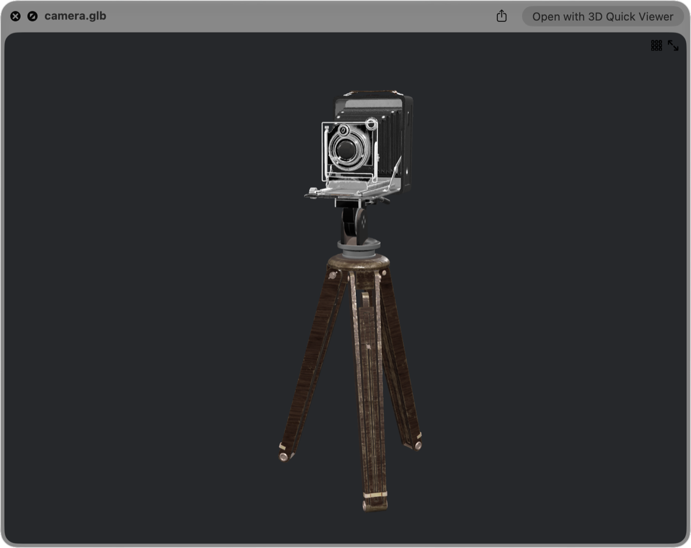

[日本語](https://github.com/magicien/VRMQuickLook/blob/master/lang/README.ja.md)

# VRMQuickLook
macOS QuickLook plugin for VRM files. (.vrm)

> [!IMPORTANT]
> **VRMQuickLook is no longer developed.** Its successor is **[3D Quick Viewer](https://apps.apple.com/app/id6804688390)** on the Mac App Store. [Details below](#moving-to-3d-quick-viewer).

## Moving to 3D Quick Viewer

Thank you to everyone who has used VRMQuickLook since 2018, and to everyone who reported issues and sent pull requests.

VRMQuickLook is a `.qlgenerator`, the older kind of Quick Look plugin. Apple introduced its replacement, Quick Look app extensions, in macOS 10.15, deprecated the old plugin API in macOS 12, and macOS 15 Sequoia no longer loads it at all. So I rebuilt VRM previews as a new app that uses the Quick Look extension mechanism Apple supports today.

### [3D Quick Viewer](https://apps.apple.com/app/id6804688390)

<a href="https://apps.apple.com/app/id6804688390"></a>

- **Same workflow:** select a file in Finder and press Space. Finder icons show thumbnails of the model too.
- **Simple install:** get it from the Mac App Store and open it once. No Terminal, no `qlmanage -r`.
- **Better VRM support:** VRM 0.x and 1.0, MToon shading, the embedded thumbnail, and the model's license information. VRM Animation (.vrma) can be played on a model.
- **More formats:** glTF, MikuMikuDance (.pmx / .pmd / .vmd), FBX, USD, STL, OBJ, 3MF and others. 22 formats in total.
- **A viewer app as well:** an orbit camera, and an inspector that lists vertices, materials, bones and morphs.

It requires **macOS 15 or later**. It is a **paid app with a one-time purchase**. Sales pay for continued development, including support for new macOS versions.

### What happens to this repository

- The repository stays public, and the source code and past releases remain available under the MIT License.
- There will be no new releases, and issues and pull requests will no longer be handled.
- Forks are welcome.
- On Intel Macs with macOS 14 or earlier, the plugin keeps working as before. The instructions below are kept for those systems.

---

*Everything below is the original VRMQuickLook documentation, kept for macOS 14 and earlier.*

## System Requirements

- macOS 10.13 (High Sierra) to macOS 14 (Sonoma)
- Intel Mac. The release build contains Intel (x86_64) code only and has not been tested on Macs with Apple silicon.
- It does not work on macOS 15 (Sequoia) or later. Use [3D Quick Viewer](https://apps.apple.com/app/id6804688390) instead.


## Install

### Using [Homebrew Cask](https://github.com/phinze/homebrew-cask)

- Not available on Homebrew.

### Manually

1. Download **VRMQuickLook_vX.X.X.zip** from [Releases](https://github.com/magicien/VRMQuickLook/releases/latest).
2. Put **VRMQuickLook.qlgenerator** (in the zip file) into `/Library/QuickLook` (for all users) or `~/Library/QuickLook` (only for the logged-in user).
3. Run `qlmanage -r` command to reload QuickLook plugins. (or restart your Mac)

## Uninstall

When you switch to 3D Quick Viewer, you can remove the old plugin:

1. Delete **VRMQuickLook.qlgenerator** from `/Library/QuickLook` or `~/Library/QuickLook`.
2. Run `qlmanage -r` command to reload QuickLook plugins. (or restart your Mac)

## Build

It needs to install [Carthage](https://github.com/Carthage/Carthage) to get frameworks.
```
$ git clone https://github.com/magicien/VRMQuickLook.git
$ cd VRMQuickLook
$ carthage bootstrap --platform mac
$ xcodebuild
```

## See also

- [3D Quick Viewer](https://apps.apple.com/app/id6804688390) - The successor to this plugin. A 3D viewer with a Quick Look extension for VRM, glTF, MMD, FBX, USD, STL, OBJ and more.
- [GLTFSceneKit](https://github.com/magicien/GLTFSceneKit/) - glTF loader for SceneKit
- [GLTFQuickLook](https://github.com/magicien/GLTFQuickLook/) - macOS QuickLook plugin for glTF files.

