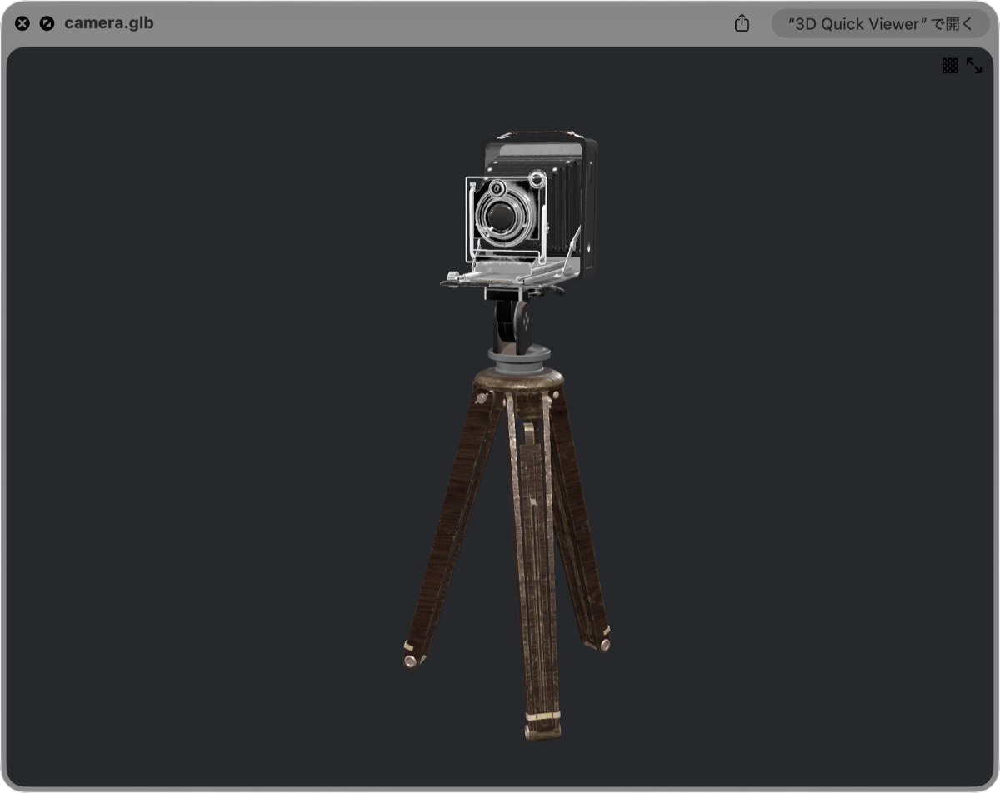

# VRMQuickLook
macOS用VRM QuickLookプラグイン

> [!IMPORTANT]
> **VRMQuickLookの開発は終了しました。** 後継はMac App Storeの **[3D Quick Viewer](https://apps.apple.com/app/id6804688390)** です。[詳しくは下記](#3d-quick-viewerへの移行について)をご覧ください。

## 3D Quick Viewerへの移行について

2018年からVRMQuickLookを使ってくださった皆さま、Issueやプルリクエストを送ってくださった皆さま、ありがとうございました。

VRMQuickLookは`.qlgenerator`という古い形式のQuickLookプラグインです。macOS 10.15で後継のQuickLook拡張が用意され、macOS 12でこの形式のAPIは非推奨になり、macOS 15 Sequoiaからは読み込まれなくなりました。そこで、Appleが現在サポートしているQuickLook拡張の仕組みを使って、新しいアプリとして作り直しました。

### [3D Quick Viewer](https://apps.apple.com/app/id6804688390)

<a href="https://apps.apple.com/app/id6804688390"></a>

- **使い方は同じ:** Finderでファイルを選んでスペースキーを押すだけ。Finderのアイコンもモデルのサムネイルになります。
- **インストールが簡単:** Mac App Storeから入れて一度起動するだけ。ターミナルでの操作は要りません。
- **VRMの対応を強化:** VRM 0.x / 1.0、MToonシェーダ、埋め込みサムネイル、モデルのライセンス表示。VRM Animation（.vrma）をモデルに重ねて再生できます。
- **ほかの形式も:** glTF、MikuMikuDance（.pmx / .pmd / .vmd）、FBX、USD、STL、OBJ、3MFなど全22形式。
- **ビューアアプリとしても:** 軌道カメラと、頂点・材質・ボーン・モーフを確認できる情報欄。

**macOS 15以降**が必要です。**買い切りの有料アプリ**です。売り上げは、新しいmacOSへの対応を含む今後の開発に充てます。

### このリポジトリについて

- リポジトリは公開したままにします。ソースコードと過去のリリースはMITライセンスで引き続き利用できます。
- 新しいリリースは出しません。Issueとプルリクエストへの対応も終了します。
- フォークは歓迎します。
- macOS 14以前のIntel Macでは、これまでどおり動作します。そのための手順は下に残してあります。

---

*ここから下は、macOS 14以前のために残しているVRMQuickLookの元の説明です。*

## 対応システム

- macOS 10.13 (High Sierra) 〜 macOS 14 (Sonoma)
- Intel Mac。配布しているビルドはIntel（x86_64）用のコードだけを含み、Appleシリコン搭載のMacでは動作を確認していません。
- macOS 15 (Sequoia) 以降では動作しません。[3D Quick Viewer](https://apps.apple.com/app/id6804688390)をお使いください。


## インストール方法

### [Homebrew Cask](https://github.com/phinze/homebrew-cask)でインストール

- Homebrewでは提供していません。

### 手動インストール

1. [Releases](https://github.com/magicien/VRMQuickLook/releases/latest)ページから最新の「**VRMQuickLook_vX.X.X.zip**」をダウンロードする
2. ZIPファイル中の「**VRMQuickLook.qlgenerator**」を `/Library/QuickLook` (全ユーザ用) か`~/Library/QuickLook` (使用中のユーザ用)にコピーする
3. ターミナルで`qlmanage -r`を実行してQuickLookプラグインの再読み込みをする。（またはMacを再起動する）

## アンインストール方法

3D Quick Viewerに切り替えたら、古いプラグインは削除できます。

1. `/Library/QuickLook` か `~/Library/QuickLook` から「**VRMQuickLook.qlgenerator**」を削除する
2. ターミナルで`qlmanage -r`を実行してQuickLookプラグインの再読み込みをする。（またはMacを再起動する）

## ビルド方法（改造したい人向け）

[Carthage](https://github.com/Carthage/Carthage)が無い場合はインストールする。
その後、下記コマンドを実行する。
```
$ git clone https://github.com/magicien/VRMQuickLook.git
$ cd VRMQuickLook
$ carthage bootstrap --platform mac
$ xcodebuild
```

## 関連リポジトリ

- [3D Quick Viewer](https://apps.apple.com/app/id6804688390) - このプラグインの後継。VRM、glTF、MMD、FBX、USD、STL、OBJなどに対応したQuickLook拡張つきの3Dビューア
- [VRMPreview](https://github.com/magicien/VRMPreview/) - macOS用VRMビューア
- [GLTFSceneKit](https://github.com/magicien/GLTFSceneKit/) - SceneKit用glTFローダ
- [GLTFQuickLook](https://github.com/magicien/GLTFQuickLook/) - macOS、glTF用QuickLookプラグイン

